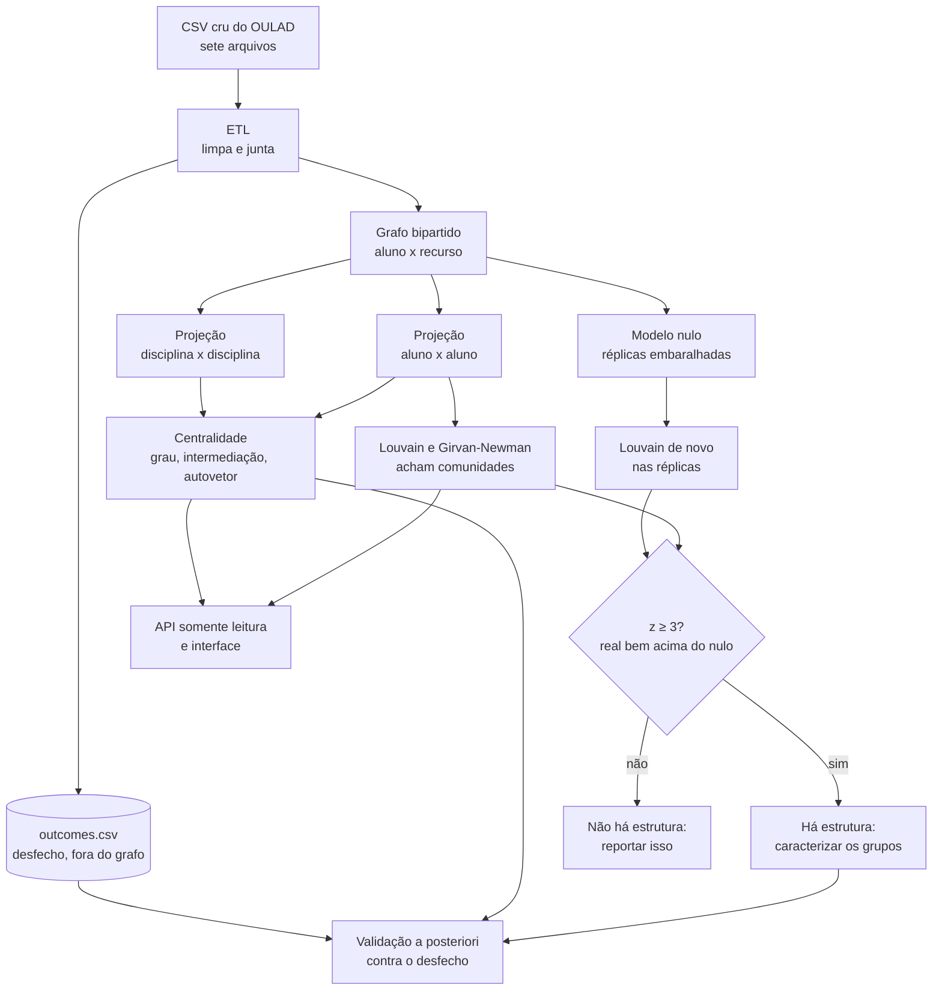

# Glossário ilustrado

Todo termo que a gente usa no projeto, explicado sem jargão e com
desenho. Se você travou numa palavra lendo um README, uma spec ou o
artigo, ela está aqui.

A ordem é de construção: cada termo usa os anteriores. Dá para ler
inteiro em uns vinte minutos, ou pular direto no que você precisa.

---

## 1. Grafo

Um grafo é só **bolinhas ligadas por riscos**. As bolinhas são os **nós**
(ou vértices). Os riscos são as **arestas**.

```
    Ana ────── Bruno
     │           │
     │           │
   Carla ───── Diego
```

Quatro nós, quatro arestas. É isso. Tudo o mais no projeto é consequência
disso.

Um grafo não tem posição: não importa se a Ana está desenhada em cima ou
embaixo. **Só importa quem está ligado a quem.**

| Termo | O que quer dizer |
|---|---|
| **nó** (vértice) | uma bolinha: um aluno, uma matéria, um material |
| **aresta** | um risco: a ligação entre duas bolinhas |
| **grau** de um nó | quantos riscos saem dele |
| **vizinhos** | os nós ligados direto a ele |

No desenho acima, todo mundo tem **grau 2**. A Ana tem dois vizinhos,
Bruno e Carla.

### Peso da aresta

Às vezes a ligação tem uma intensidade. Aí o risco carrega um número,
chamado **peso**.

```
    Ana ──(9)── Bruno        Ana e Bruno compartilham 9 coisas.
     │                       Ana e Carla compartilham só 1.
    (1)                      A ligação com Bruno é "mais forte".
     │
   Carla
```

Isso vai importar muito mais para a frente: no nosso caso, **a informação
está quase toda no peso**, não na existência do risco.

Somando os pesos de todos os riscos de um nó, tem-se a **força** do nó
(ou grau ponderado). A Ana acima tem grau 2 e força 10.

---

## 2. Grafo bipartido

"Bipartido" quer dizer **dois times**. Os nós se dividem em dois grupos, e
**as arestas só ligam um time ao outro, nunca dentro do mesmo time**.

No projeto, o time da esquerda são os alunos e o da direita é o que eles
consomem.

```
   ALUNOS              MATÉRIAS
   (time U)            (time V)

    Ana ──────────────── Cálculo
      ╲                ╱
       ╲──────────── Física
      ╱
   Bruno ───────────── Química

   Carla ───────────── Cálculo
```

Repare: **não existe risco de Ana direto para Bruno.** Aluno não liga com
aluno. Matéria não liga com matéria. Só atravessando.

Por que isso é útil? Porque é o formato natural do dado educacional. A
base não diz "Ana é parecida com Carla". Ela diz "Ana cursou Cálculo" e
"Carla cursou Cálculo". A semelhança entre Ana e Carla é algo que a gente
**vai ter que deduzir**.

> No código os dois times aparecem como `kind="student"` e
> `kind="discipline"`. O nome `discipline` marca **o lado**, não a
> natureza do nó — mesmo quando o lado direito virou "recurso do
> ambiente virtual", o rótulo continua `discipline`. Foi de propósito:
> mudar o rótulo quebraria o código das Frentes B e C sem ganho nenhum.
> Pelo mesmo motivo, tabelas e figuras às vezes dizem "disciplina" para
> um recurso do AVA.

---

## 3. Projeção

Esse é o passo central do trabalho, e o nome assusta mais do que a ideia.

**Projetar é achatar o grafo bipartido num grafo de um time só.**

Se Ana e Carla cursaram a mesma matéria, a gente cria um risco direto
entre elas. A matéria some do desenho; ela vira a *justificativa* do
risco.

```
   ANTES (bipartido)              DEPOIS (projeção de alunos)

   Ana ──── Cálculo ──── Carla        Ana ───────── Carla
     ╲                                  ╲           ╱
      ╲──── Física ──── Bruno            ╲         ╱
                                          ╲       ╱
                                           Bruno
                                     (Ana-Bruno porque
                                      dividiram Física)
```

Agora sim temos aluno ligado a aluno, que é o que precisamos para
procurar grupos.

Dá para projetar para os dois lados:

| Projeção | Um risco significa |
|---|---|
| **de alunos** | esses dois alunos compartilham material |
| **de matérias** | essas duas matérias têm alunos em comum |

A projeção de alunos responde "quem estuda parecido com quem". A de
matérias responde "quais matérias são gargalo", que é a outra metade do
objetivo do trabalho.

### As duas formas de calcular o peso

Aqui há uma escolha, e ela acabou virando um dos achados do trabalho.

**Contagem simples.** O peso é quantas coisas os dois compartilham.

```
   Ana e Carla dividiram 3 materiais  →  peso 3
   Ana e Bruno dividiram 1 material   →  peso 1
```

Simples, mas tem um defeito sério: quem acessa muita coisa acaba com peso
alto com **todo mundo**. O peso passa a medir o quanto a pessoa é ativa,
não o quanto as duas se parecem.

**Alocação de recursos** (Zhou et al., 2007). Cada material distribui uma
quantidade fixa de "água" entre quem o acessou, então **material
disputado por muita gente vale menos**.

```
   Material que só 2 alunos usaram   →  vale muito (é específico)
   Material que 500 alunos usaram    →  vale pouco (todo mundo usa)
```

É a mesma intuição de "ter um hobby raro em comum diz mais sobre vocês do
que os dois respirarem".

> **Achado do projeto.** As duas dão resultados diferentes, e a diferença
> importa. Quando filtramos só as ligações mais fortes, a contagem
> simples passou a apontar estrutura *pior que o acaso*, enquanto a
> alocação de recursos continuou apontando estrutura real. Motivo: as
> ligações mais pesadas na contagem simples eram só "os alunos mais
> ativos entre si".

> No código, lado e ponderação formam o **`projection_id`**:
> `student_simple`, `student_resource_allocation`, `discipline_simple` e
> `discipline_resource_allocation`. É o nome da pasta em disco e o que
> aparece em toda tabela.

---

## 4. Granularidade

Granularidade é **o que conta como "uma coisa" no lado direito** do
bipartido.

A mesma base pode virar grafos bem diferentes dependendo dessa escolha.
São duas famílias: as que olham para a **matrícula** (o que o aluno
cursou) e as que olham para o **comportamento** (o que ele fez no
ambiente virtual).

```
MATRÍCULA                       GROSSO ──────────────────────> FINO

  matéria          matéria+turma        avaliação
  ("Cálculo")      ("Cálculo 2013")     ("Prova 1")
  7 nós            22 nós               ~200 nós na base

COMPORTAMENTO                   GROSSO ──────────────────────> FINO

  tipo de atividade                     recurso do AVA
  ("vídeo", "fórum")                    ("vídeo da aula 3")
  20 nós                                6.364 nós na base
```

Por que isso é decisivo? Porque define quantos vizinhos cada aluno tem.

| Granularidade | Grau mediano do aluno |
|---|---|
| matéria | **1** |
| matéria + turma | **1** |
| avaliação | cerca de 10, mas todo mundo faz as mesmas |
| tipo de atividade | 7 |
| **recurso do ambiente virtual** | **40** |

Com **1**, não dá para fazer nada. Um aluno ligado a uma única matéria
não tem como ser comparado com ninguém de forma interessante — ele fica
ligado a todos os colegas daquela matéria, com peso 1, e a ninguém mais.
E é o caso de 91,8% dos alunos do OULAD.

```
   GRANULARIDADE GROSSA (grau 1)      GRANULARIDADE FINA (grau 40)

   Todos de Cálculo:                  Cada aluno tem um conjunto
   um bolo indistinguível             próprio de materiais

      ●───●───●                          ●──────●
      │ ╳ │ ╳ │                          │╲    ╱│
      ●───●───●                          │ ╲  ╱ │
                                         │  ╳╱  │
   Todos iguais a todos.                 ●──────●
   Não há grupo a achar.
                                      Dá para distinguir perfis.
```

> No código isso é o campo `granularity`. Os valores possíveis são
> `module`, `module_presentation`, `assessment`, `vle_site` e
> `vle_activity_type`. Os três primeiros usam **matrícula**; os dois
> últimos usam **comportamento** (ADR-0012).

A granularidade grossa não foi descartada: ela é ruim para a projeção de
**alunos**, mas a projeção de **matérias** por `module_presentation` (22
nós, 93 das 231 ligações possíveis) é justamente a que a Frente C usa
para achar matérias-gargalo.

---

## 5. Critério de aresta

Se granularidade é *o que* é o nó, critério de aresta é **o que faz o
risco existir**.

Cursar a matéria já basta? Precisa ter passado? Precisa ter nota acima de
40? Precisa ter clicado no material?

| Critério | O risco existe quando |
|---|---|
| `score_threshold` | a nota passou de um valor (`threshold`; 40 no OULAD) |
| `final_result_pass` | o aluno foi aprovado |
| `vle_activity` | o aluno interagiu com o material |

Essa escolha muda completamente o grafo, e foi ela que a gente acabou
trocando no meio do projeto: de `score_threshold` (matrícula) para
`vle_activity` (comportamento). Não é mudança de tema — o critério é
parâmetro desde o dia 0 (ADR-0007).

Um efeito colateral que vale lembrar: com `score_threshold = 40`, quem
nunca tirou nota acima de 40 **fica fora do grafo**. No OULAD são 3.674
alunos, justamente os que mais reprovam.

---

## 6. AVA (ambiente virtual de aprendizagem)

É o "Moodle" da base: a plataforma onde o aluno abre vídeo, lê texto,
entra no fórum, faz questionário. A base registra **cada clique** — são
cerca de 10,6 milhões de linhas.

São 6.364 **recursos** (ou materiais; no texto as duas palavras querem
dizer a mesma coisa) em 20 tipos de atividade. Foi aí que encontramos a
informação que faltava — porque um aluno interage com dezenas de
recursos, mesmo cursando uma matéria só.

A base inteira do AVA não cabe numa projeção de alunos, então o trabalho
usa uma **coorte**: a turma BBB 2013J, com 1.870 alunos e 320 recursos
(`oulad_vle_bbb_2013j`). A projeção aluno↔aluno dela tem 1,7 milhão de
ligações e é **quase completa** (densidade 1,000): todo aluno está ligado
a todo aluno, e o que distingue um par do outro é só o peso.

---

## 7. Comunidade e modularidade

**Comunidade** é um grupo de nós que se ligam muito entre si e pouco com
o resto. É o que estamos procurando.

```
    ●───●           ●───●
    │ ╲ │           │ ╲ │
    ●───●───────────●───●
                ↑
       grupo A   │   grupo B
            uma ligação só
              entre eles
```

Dois grupos bem separados. Ninguém precisa de algoritmo para ver isso num
desenho de 8 nós — mas com 1.870 alunos e 1,7 milhão de ligações, precisa.

Uma divisão dos nós em comunidades se chama **partição**. Cada nó cai em
exatamente uma comunidade.

**Modularidade** (o tal do **Q**) é uma nota que diz **o quanto uma
partição é boa**: compara quantas ligações ficam dentro dos grupos com
quantas ficariam se as ligações fossem sorteadas. Na prática fica entre
0 e 1 (pode até ser negativa, se a divisão for pior que o sorteio).
Quanto mais as ligações ficam dentro dos grupos e menos atravessam, maior
o Q.

```
   Q alto  →  ●─●─●      ●─●─●     grupos densos, pouca ponte
                  └────────┘

   Q baixo →  ●─●─●─●─●─●─●        tudo ligado com tudo,
              ╲_╱ ╲_╱ ╲_╱          divisão não significa nada
```

### Os dois algoritmos

Não são IA: não têm treino, não têm exemplo rotulado, não aprendem nada.
São contas fechadas sobre a estrutura do grafo.

**Louvain.** Começa com cada nó sozinho e vai juntando grupos enquanto o
Q sobe. É guloso e muito rápido. Usamos a biblioteca `python-louvain`,
mas o Q que vai para as tabelas é **sempre calculado à mão** (spec B-03),
pela fórmula que o artigo descreve.

**Girvan-Newman.** Faz o caminho inverso: começa com o grafo inteiro e
vai **removendo a ponte mais usada** (a aresta de maior intermediação,
ver seção 9) até o grafo se partir; de todos os cortes, fica com o de
maior Q. É lento: em `synthetic_v1` levou 34,4 s contra 0,024 s do
Louvain — **1.453× mais lento, e com Q menor**.

Por isso o Girvan-Newman roda com **orçamento de tempo** (ADR-0006). Se
estourar, ele não dá erro: devolve a melhor partição que viu até ali,
marcada com `status="timeout"`. Isso é resultado a reportar, não falha.

> **Um k maior não é uma partição melhor.** `k` é o número de
> comunidades. Na projeção de matérias, o Girvan-Newman achou k = 4, mas
> três das quatro comunidades tinham um nó só. Ao citar k, diga quantas
> são unitárias.

### Descrever e comparar comunidades

Achar os grupos não basta: é preciso dizer **o que eles têm em comum**.

**Perfil** da comunidade é a lista das matérias que a caracterizam,
ordenadas por **frequência em excesso**: quanto a matéria aparece mais
na comunidade do que na base inteira. A matéria obrigatória que todo
mundo cursa aparece em todo grupo e por isso não caracteriza nenhum.

Para saber se duas partições concordam — Louvain contra Girvan-Newman,
ou a partição encontrada contra os grupos plantados no dado sintético —,
usamos três medidas:

| Medida | Pergunta que responde |
|---|---|
| **pureza** | cada comunidade é homogênea? (sobe sempre que se divide mais) |
| **NMI** (informação mútua normalizada) | as duas partições contam a mesma história? 1 = idênticas, 0 = sem relação |
| **ARI** (índice de Rand ajustado) | quantos pares de nós as duas põem juntos/separados do mesmo jeito, descontado o acaso |

São contas sobre duas partições já prontas, implementadas à mão. Não são
modelos e não aprendem nada.

> **Por que reportar pureza e NMI juntas.** Em `synthetic_v2`, com 70%
> dos alunos numa matéria só, a pureza quase não cai (0,86), mas o NMI
> cai pela metade (0,50). Só a pureza diria que o método resiste à
> esparsidade — e ele não resiste.

---

## 8. Modelo nulo — a ideia mais importante do projeto

Esta é a parte que vale a pena entender de verdade, porque foi ela que
salvou o trabalho de concluir o contrário do certo.

**O problema:** a modularidade sempre acha alguma coisa. Mesmo num grafo
totalmente aleatório, o algoritmo devolve grupos e um Q até alto. Um Q de
0,77 parece ótimo, mas sozinho não prova nada.

**A solução:** embaralhar e comparar.

```
   GRAFO REAL                    RÉPLICAS EMBARALHADAS
   (quem acessou o quê)          (mesmos números, ligações sorteadas)

      Ana ── vídeo 1                Ana ── fórum 7
      Ana ── vídeo 2                Ana ── vídeo 5
    Bruno ── vídeo 1              Bruno ── texto 3

        ↓ rodar Louvain               ↓ rodar Louvain

        Q = 0,77                      Q = 0,78
                    ╲            ╱
                     ╲          ╱
              O real NÃO é melhor que o acaso.
              Então o 0,77 não significa nada.
```

Cada **réplica** é uma versão embaralhada do bipartido:

- **igual, exatamente:** os mesmos alunos, os mesmos materiais, o mesmo
  total de ligações, e cada aluno com o mesmo número de ligações que
  tinha;
- **igual, em média:** quantos alunos cada material tem (o material é
  sorteado com chance proporcional ao seu tamanho real);
- **destruído de propósito:** quem-se-liga-com-quem. Toda estrutura real
  some.

O peso de toda ligação da réplica é 1: o nulo é sobre a forma do grafo,
não sobre as notas.

Se o Q real não for maior que o das réplicas, não há estrutura a
reportar. Foi exatamente o que aconteceu com a modelagem por matéria, e é
por isso que trocamos para o AVA.

| Base | Q real | Q embaralhado | Leitura |
|---|---|---|---|
| sintética (grupos plantados) | 0,4666 | 0,2079 | tem estrutura |
| OULAD por matéria (amostra de 3.000 alunos) | 0,7728 | 0,781 | **não tem** |
| OULAD pelo AVA (coorte BBB 2013J) | 0,0825 | 0,0158 | tem estrutura |

Repare no detalhe que engana: o Q de **0,77** não vale nada e o de
**0,08** vale. O número sozinho não diz nada — **só a comparação diz**.

### O critério: z ≥ 3

Para não decidir no olho, a Frente B fixou uma régua (spec B-06):

```
        Q real − média do Q das réplicas
   z = ──────────────────────────────────
           desvio do Q das réplicas
```

O **z** diz a quantos "passos de acaso" o Q real está das réplicas. Com
pelo menos **cinco réplicas** e **z ≥ 3**, dizemos que há estrutura;
abaixo disso, "indistinguível do acaso"; com menos de cinco réplicas, não
há veredito. No sintético, z = +15,4.

Não é teste de significância estatística — é só uma distância, que
separa "muito acima" de "no meio do sorteio".

---

## 9. Centralidade

Centralidade responde **quais nós são importantes**. Há três formas, e
cada uma define "importante" de um jeito. A Frente C calcula as três.

**Grau.** Importante = tem muitos vizinhos. É a contagem crua.

```
      ●
      │
  ●───●───●     o nó do meio tem grau 4
      │
      ●
```

**Intermediação** (betweenness). Importante = está no caminho dos outros.
É o gargalo, a ponte.

```
   ●───●           ●───●
   │ ╲ │           │ ╲ │
   ●───●─── X ─────●───●

   X tem grau baixo, mas TODO caminho de um lado
   para o outro passa por ele. Tirando X, o grafo
   se parte em dois. Intermediação altíssima.
```

No contexto educacional, é o candidato natural a "matéria gargalo".

**Autovetor** (eigenvector). Importante = está ligado a quem é
importante. É recursivo, e é a mesma ideia do PageRank do Google.

```
   Estar ligado a 10 nós irrelevantes  <  estar ligado a 2 nós centrais
```

### O peso no caminho: `weight_mode`

Na intermediação, o peso atrapalha. Para achar o **caminho mais curto**,
o peso precisa ser uma *distância* — mas, nas nossas projeções, peso
alto quer dizer *perto* (muitos alunos em comum). Por isso há três modos:

| `weight_mode` | O caminho é medido em | Quando usamos |
|---|---|---|
| `none` | **saltos**: cada risco vale 1, o peso é ignorado | padrão, em projeção esparsa (as matérias) |
| `inverse` | distância `1/peso`: risco pesado vira atalho | projeção quase completa (alunos no AVA) |
| `raw` | o peso como distância | nunca: inverteria o sentido |

Em projeção quase completa, todo mundo é vizinho de todo mundo, nenhum
caminho passa por um terceiro e a intermediação em saltos dá zero para
todos. Ali só o peso distingue.

**Pivôs.** Em grafo grande, a intermediação exata não termina. Sorteiam-se
`k` nós de partida (os **pivôs**, com `seed` fixa) e o valor vira uma
**estimativa** — o artefato grava `estimate = true`, e a tabela precisa
dizer isso.

### Como o autovetor é calculado

Por **iteração de potência**, à mão: começa com todos os nós valendo o
mesmo, e repete "cada nó passa a valer a soma dos vizinhos" até os
números pararem de mudar. Um detalhe que a banca pode perguntar: a conta
é feita sobre `A + I` (cada nó também "vota em si mesmo"), porque em
grafo bipartido a versão pura fica oscilando para sempre entre dois
resultados. Se mesmo assim não convergir, há um **fallback** (plano B)
por decomposição espectral — que nunca foi preciso no OULAD.

### Disciplinas críticas e discordância

**Disciplina crítica** é a que aparece no topo de uma das métricas. O
interessante é onde as três **discordam**:

```
   Topo da intermediação, mas não do grau  →  ponte sem ser popular
                                               (o gargalo de verdade)
   Topo do autovetor, mas não do grau      →  vizinha de quem é grande
```

No OULAD, nenhuma disciplina está no top 5 das três métricas ao mesmo
tempo. A concordância entre dois rankings é medida pela **correlação de
Spearman** (1 = mesma ordem, 0 = sem relação): grau × autovetor dá 0,84
(medem quase o mesmo), intermediação × autovetor dá só 0,21.

---

## 10. Validação a posteriori

"A posteriori" quer dizer **depois**. Primeiro o algoritmo roda, sem
nenhum rótulo. Só então abrimos o `outcomes.csv` e perguntamos: os grupos
e os nós centrais que a topologia achou têm alguma relação com o
desempenho?

O **desfecho** de cada matrícula no OULAD é `Pass`, `Distinction`,
`Fail` ou `Withdrawn`. A **não conclusão** junta `Fail` e `Withdrawn`:
para a gestão, desistir também é não concluir.

Para os alunos, a comparação é por **quartil**: divide-se a turma em
quatro faixas de centralidade, da menor (Q1) para a maior (Q4), e
olha-se a taxa de não conclusão em cada faixa.

```
   Alunos no AVA (BBB 2013J), por autovetor:

   Q1 (menos central)  ████████████████████  89%
   Q2                  ████████████          53%
   Q3                  ████                  18%
   Q4 (mais central)   ██                    11%
```

O sinal é forte — mas **não é previsão**. Quem desiste para de acessar o
AVA e, por isso, fica com menos em comum com os colegas. A centralidade
aqui mede sobretudo o volume de engajamento acumulado, que o próprio
desfecho trunca.

Do lado das disciplinas o sinal quase some: as cinco de maior
intermediação têm só 1,2 ponto percentual de não conclusão acima da
base. **Ser ponte no currículo não é o mesmo que ser difícil.**

> Este "Q1…Q4" é quartil, não modularidade. Mesma letra, outra coisa.

---

## 11. A aplicação: API e interface

O que as frentes produzem também pode ser explorado numa tela.

**API** é o "balcão" que entrega os artefatos para outro programa. A
nossa é **somente leitura** (ADR-0004): só consulta o que está em disco,
nunca recalcula nem grava nada. Cada rota devolve uma coisa —
`/datasets`, a projeção, o bipartido, as comunidades, a centralidade e
as tabelas de métricas.

```
   arquivos em disco ──> API (FastAPI) ──> interface no navegador
   (data/processed)      só lê              (React + Cytoscape.js)
```

**Esqueleto.** Um grafo de 1,7 milhão de ligações não se desenha. A API
manda no máximo 5.000 por resposta e, por padrão, escolhe as `k`
ligações mais fortes **de cada nó** (`cut=backbone`), com o maior `k`
que caiba. Pegar as 5.000 mais pesadas do grafo inteiro deixaria 90% dos
alunos soltos na tela. Captura de tela de grafo grande mostra o
esqueleto, e a legenda precisa dizer isso.

**Interface** (o "front"). Cor do nó = comunidade, tamanho = centralidade,
e um painel com os números. As cores são da paleta de **Okabe & Ito**,
feita para quem tem daltonismo, e cada comunidade ganha também uma
**forma** (círculo, triângulo, quadrado…), para continuar legível
impressa em preto e branco.

> As figuras do artigo **não** saem da interface: saem de
> `reporting/figures.py`, com matplotlib.

---

## 12. Termos do dia a dia do repositório

### Sobre o grafo

| Termo | O que é |
|---|---|
| **coorte** | um recorte de turma, tipo "matéria BBB, entrada de 2013". Usamos porque a base inteira não cabe na memória |
| **amostra** | um sorteio de nós, para caber em memória ou em tempo. Partição feita sobre amostra ganha o sufixo `__sample<N>` no nome, para ninguém confundir com a do grafo inteiro |
| **densidade** | fração dos riscos possíveis que existem de fato. 1,0 = todo mundo ligado com todo mundo |
| **grafo completo** | densidade 1,0. Ruim para nós: se todos estão ligados a todos, não há grupo a distinguir |
| **esparso** | poucos riscos. O oposto de denso |
| **componente** | pedaço do grafo que não se conecta ao resto |
| **nó isolado** | nó sem nenhum risco. É removido do bipartido |
| **extração de espinha** | jogar fora as ligações fracas do grafo inteiro e ficar só com as fortes. Ajuda a enxergar, mas quebra o grafo em pedaços se exagerar. Não confundir com o **esqueleto** da API (seção 11), que guarda as mais fortes **de cada nó** |
| **réplica** | uma cópia embaralhada do bipartido, usada como modelo nulo. `oulad_vle_bbb_2013j_null0` a `null4` são cinco delas |

### Sobre o código e o processo

| Termo | O que é |
|---|---|
| **artefato** | arquivo de resultado gravado em disco (`nodes.csv`, `edges.csv`, `meta.json`). É como as frentes conversam |
| **dataset** | uma pasta em `data/processed/` (ou `data/fixtures/`) com todos os artefatos de uma configuração: bipartido, projeções, comunidades, centralidades |
| **contrato** | o formato acordado desses arquivos (`src/edugraph/contracts/`). Está congelado: mudar exige ADR e aval dos três |
| **`params` e `meta.stats`** | dicionários livres dentro do artefato, para registrar o que só interessa a quem produziu. Usar antes de pensar em mudar contrato |
| **`outcomes.csv`** | o arquivo com desfecho, notas e dados demográficos, separado do grafo. Só pode ser lido por módulos chamados `evaluate.py` |
| **configuração** | um arquivo TOML em `configs/` que descreve uma rodada inteira. Cada configuração é uma linha das tabelas do capítulo 3 |
| **estágio** | uma etapa da rodada: `data` (Frente A), `community` (B), `centrality` (C). `python -m edugraph run configs/x.toml --only community` roda só um |
| **implementação à mão** | o algoritmo escrito por nós, comparado com a versão da biblioteca (NetworkX) como referência. O artigo exige as duas (ADR-0010) |
| **orçamento** e **`status`** | o limite de tempo de um algoritmo lento. `status` diz como a execução terminou: `ok`, `timeout` ou `skipped` |
| **ADR** | registro curto de uma decisão de arquitetura e do porquê dela (`docs/adr/`) |
| **spec** | o documento de uma tarefa: objetivo, escopo, critérios de aceite. Tem id, tipo `A-04` ou `C-06` |
| **frente** | a divisão do trabalho por assunto. A é dados e modelagem, B é comunidades, C é centralidade e aplicação |
| **observação** | pendência registrada no arquivo da frente, em `observacoes/`: o que não deu para corrigir na hora fica anotado, e qualquer integrante resolve |
| **fixture** | base pequena e fixa usada nos testes (`tiny_v1`, `synthetic_v1`, `synthetic_v2`). Nunca muda |
| **dado sintético** | base gerada por nós, com grupos **plantados** de propósito. Serve para provar que o método acha estrutura quando ela existe. Nunca se mistura com o OULAD |
| **seed** | número que faz o sorteio dar sempre o mesmo resultado. Todo algoritmo com aleatoriedade recebe uma, e ela fica gravada no artefato |
| **ETL** | o processo de ler os arquivos crus, limpar e juntar numa tabela usável |
| **OULAD** | a base que usamos, da Open University (Reino Unido): 7 módulos, 22 apresentações, ~32 mil matrículas e ~10,6 milhões de cliques no AVA |
| **`xfail`** | marca de teste que **deve** falhar enquanto a spec está aberta. Quando a spec fecha e o teste passa, a CI quebra de propósito, para lembrar de tirar a marca |
| **CI** | a checagem automática que roda os testes em todo PR. `main` só aceita PR com CI verde |

---

## 13. As tecnologias

| Tecnologia | Para que serve aqui |
|---|---|
| **Python 3.11** | a linguagem de todo o pipeline |
| **NetworkX** | biblioteca de grafos. Guarda o grafo na memória e serve de **referência** para conferir as implementações à mão |
| **pandas** e **NumPy** | tabelas e contas com vetores: o ETL, os artefatos, as métricas |
| **SciPy** | álgebra de matrizes esparsas (o plano B do autovetor) e o ranking da correlação de Spearman |
| **python-louvain** | a implementação do Louvain que usamos |
| **matplotlib** | as figuras do artigo |
| **FastAPI** e **uvicorn** | a API somente leitura e o servidor que a põe no ar |
| **React**, **Vite** e **TypeScript** | a interface no navegador (`frontend/`). Vite compila; o resultado é servido pela própria API |
| **Cytoscape.js** | a biblioteca que desenha o grafo na interface |
| **pytest** | os testes. `pytest -m "not slow"` é o que a CI roda |
| **ruff** e **mypy** | estilo/formatação e checagem de tipos. O mypy roda em modo estrito sobre `contracts/` |
| **TOML** | o formato dos arquivos de `configs/` |
| **Mermaid** | os diagramas desenhados como texto nos `.md`, como o da próxima seção |

Tudo é chamado por `python -m edugraph …`. Nada de `make`: o grupo
trabalha em Windows.

---

## 14. O caminho inteiro, de ponta a ponta



A **Frente A** entrega o bipartido, as projeções, o modelo nulo e o
`outcomes.csv`. A **Frente B** acha as comunidades, compara com o nulo e
caracteriza os grupos. A **Frente C** calcula as centralidades, faz a
validação contra o desfecho e monta a API e a interface. Nenhuma frente
importa o código da outra: tudo passa pelos artefatos em disco.

---

## 15. O que este trabalho não faz, e por quê

Não usamos **nenhuma** técnica de aprendizado de máquina. Nada de
`sklearn`, nada de rede neural, nada de k-means, nada de classificador.

Não é limitação técnica, é a proposta. O trabalho mostra que dá para
achar agrupamentos interpretáveis **só com Teoria dos Grafos**, sem
treinar modelo nenhum e sem usar rótulo nenhum como entrada.

Por isso as notas e o resultado final da matrícula ficam guardados num
arquivo separado, longe do grafo. Eles só entram **depois**, para
conferir se os grupos que a topologia achou têm alguma relação com o
desempenho (seção 10). Se entrassem antes, a conclusão seria circular.

O mesmo vale para NMI, Rand ajustado e pureza (seção 7): comparam duas
partições já prontas. Não são modelos, não treinam, não preveem.

E o trabalho também **não prevê evasão**. Comunidades e centralidades
descrevem a estrutura; a relação com o desfecho é conferida depois, e o
texto não pode afirmar mais do que isso.

> Há um teste automático que quebra a build se alguém importar uma
> biblioteca de aprendizado de máquina, e outro que quebra se alguém ler
> o arquivo de notas de um lugar não autorizado. A regra é verificada,
> não confiada.
